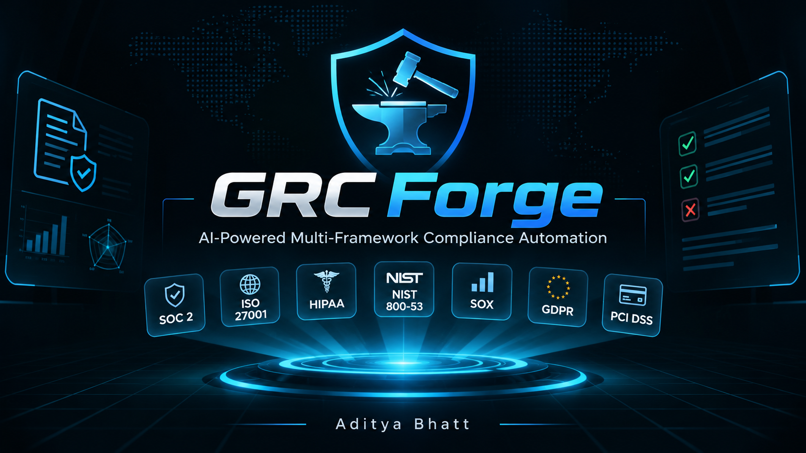
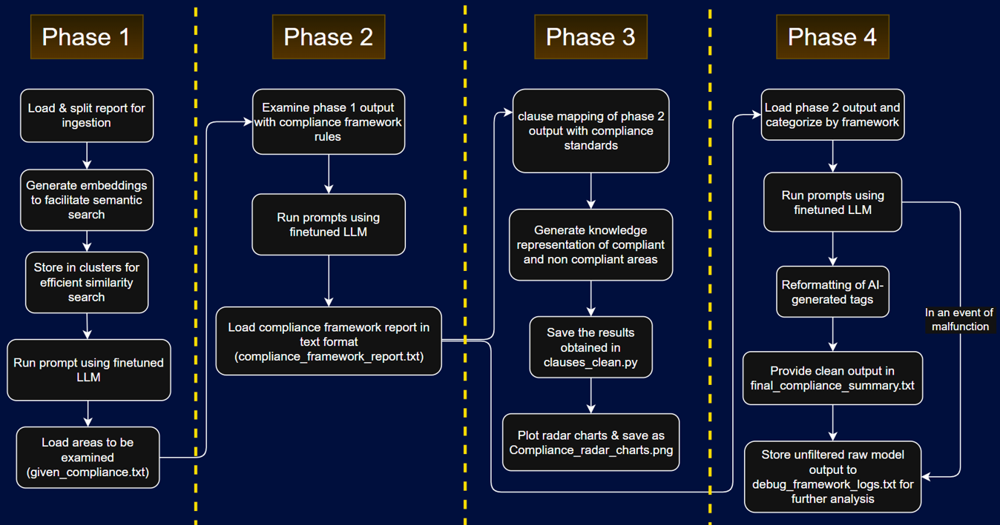
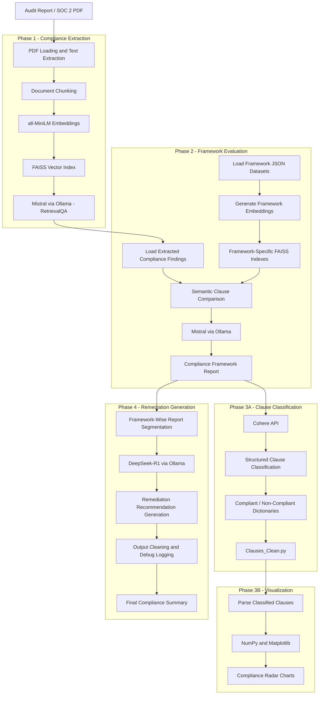

# 🛡️ GRC-Forge
### AI-Powered Multi-Framework Governance, Risk & Compliance Automation

<br/>  <br/>

<p align="center">
  <strong>Transforming Compliance Assessment Through Retrieval-Augmented Generation, Local LLMs & Intelligent Framework Mapping.</strong>
</p>

<p align="center">
  <a href="https://github.com/AdityaBhatt3010/GRC-Forge">
    
  </a>
  <a href="https://hub.docker.com/repository/docker/adityabhatt3010/grc-forge-auto/general">
    
  </a>
  
  
  
</p>

---

## 📌 Overview

**GRC-Forge** is a modular, AI-assisted Governance, Risk, and Compliance (GRC) automation framework designed to streamline the assessment of organizational security controls against multiple industry-recognized regulatory and security frameworks.

Traditional compliance assessments frequently involve reviewing extensive audit documentation, manually mapping organizational controls to framework requirements, identifying compliance gaps, and preparing remediation recommendations.

GRC-Forge approaches this workflow through an intelligent, multi-stage processing architecture combining:

- Retrieval-Augmented Generation (RAG)
- Large Language Models (LLMs)
- Natural Language Processing (NLP)
- Semantic search and vector embeddings
- Framework-specific control mapping
- Automated compliance classification
- AI-assisted remediation recommendations
- Data-driven compliance visualization

The platform transforms unstructured audit documentation into structured compliance findings, framework-wise assessments, and actionable remediation summaries.

Its architecture combines locally hosted language models with API-assisted processing, providing a flexible foundation for controlled and extensible compliance assessment workflows.

### Project Highlights

- Multi-framework compliance assessment through a unified pipeline.
- Semantic retrieval using FAISS vector indexes.
- Local LLM inference through Ollama.
- Automated compliant and non-compliant clause classification.
- Framework-specific remediation recommendations.
- Visual compliance posture representation through radar charts.
- Docker-based deployment and environment reproducibility.
- Automated dependency provisioning and execution through PowerShell.

---

## 🎯 Supported Compliance Frameworks

GRC-Forge currently includes structured datasets for seven compliance and security frameworks.

| Framework | Description |
|---|---|
| ISO/IEC 27001 | Information Security Management Systems |
| SOC 2 | Service Organization Control 2 |
| HIPAA | Health Insurance Portability and Accountability Act |
| GDPR | General Data Protection Regulation |
| NIST SP 800-53 Rev. 5 | Security and Privacy Controls |
| PCI DSS | Payment Card Industry Data Security Standard |
| SOX | Sarbanes-Oxley Act |

Framework requirements are maintained in JSON datasets, allowing the assessment engine to retrieve and compare control requirements independently for each framework.

The modular dataset architecture also provides a foundation for integrating additional compliance standards.

---

## 🏗️ System Architecture

GRC-Forge follows a modular, multi-stage processing architecture.

The pipeline converts audit documentation into framework-specific compliance intelligence through five logical processing stages.

### Architecture Workflow

 <br/>



### Phase 1: Compliance Document Extraction

**Objective:** Extract security-relevant compliance information from unstructured audit documentation.

Processing:

1. Load audit reports in PDF format.
2. Split extracted document text into manageable chunks.
3. Generate semantic embeddings using Hugging Face sentence-transformer models.
4. Store document embeddings in a FAISS vector database.
5. Execute retrieval-based queries using LangChain's RetrievalQA architecture.
6. Use Mistral through Ollama to identify relevant compliance information.

**Output:** `Given_Compliance.txt`

This file contains the extracted compliance information used by subsequent assessment stages.

### Phase 2: Multi-Framework Compliance Evaluation

**Objective:** Evaluate extracted organizational compliance information against multiple security and regulatory frameworks.

Processing:

1. Load the extracted compliance findings.
2. Load framework-specific JSON datasets.
3. Generate embeddings for individual framework requirements.
4. Build and maintain separate FAISS vector indexes for each framework.
5. Perform semantic retrieval and comparison using RetrievalQA.
6. Evaluate relevant organizational controls against framework requirements.
7. Generate framework-wise assessment findings.

**Output:** `Compliance_Framework_Report.txt`

The report contains framework-specific compliance observations and identified gaps.

### Phase 3A: Clause Classification and Mapping

**Objective:** Convert unstructured compliance evaluation results into structured framework-specific clause classifications.

Processing:

1. Load the framework evaluation report.
2. Submit the findings to the Cohere API using a constrained classification prompt.
3. Extract framework-specific clause identifiers and control references.
4. Separate findings into compliant and non-compliant categories.
5. Structure the resulting information into Python dictionaries.

**Output:** `Clauses_Clean.py`

The resulting dictionaries provide structured inputs for subsequent visualization.

### Phase 3B: Compliance Visualization

**Objective:** Provide a visual representation of framework-wise compliance coverage and identified gaps.

Processing:

1. Load structured clause dictionaries.
2. Process compliant and non-compliant clause distributions.
3. Generate radar visualizations using Matplotlib and NumPy.
4. Export the resulting compliance charts.

**Output:** `Compliance_Radar_Charts.png`

These visualizations provide a comparative overview of compliance findings across supported frameworks.

### Phase 4: Intelligent Remediation Recommendations

**Objective:** Generate human-readable compliance summaries and suggested corrective measures.

Processing:

1. Load `Compliance_Framework_Report.txt`.
2. Segment the report into framework-specific sections.
3. Submit findings to DeepSeek-R1 through Ollama.
4. Generate remediation suggestions for identified non-compliant observations.
5. Preserve compliant findings and their contextual information.
6. Clean model-generated artifacts from the final output.
7. Maintain raw model responses for debugging and review.

**Outputs:**

- `Final_Compliance_Summary.txt`
- `Debug_Framework_Logs.txt`

The final summary presents framework-wise compliance observations alongside suggested corrective measures.

---

## ⚙️ Technology Stack

| Category | Technologies |
|---|---|
| Programming Language | Python 3.11 |
| AI / LLM | Mistral, DeepSeek-R1 |
| LLM Runtime | Ollama |
| AI Orchestration | LangChain |
| Retrieval Architecture | Retrieval-Augmented Generation (RAG) |
| Embeddings | Hugging Face, all-MiniLM |
| Vector Database | FAISS |
| NLP / Classification | Cohere API |
| Data Processing | Python, JSON |
| Visualization | Matplotlib, NumPy |
| Containerization | Docker |
| Automation | PowerShell |
| Development | Jupyter Notebook |

---

## 🚀 Deployment

GRC-Forge supports containerized execution as well as automated local environment provisioning.

### Option 1: Docker Hub

The project has a published Docker image.

**Docker Hub Repository:**

https://hub.docker.com/repository/docker/adityabhatt3010/grc-forge-auto/general

Pull the published image:

```bash
docker pull adityabhatt3010/grc-forge-auto:latest
```

Alternatively, build the container locally from the repository:

```bash
git clone https://github.com/AdityaBhatt3010/GRC-Forge.git

cd GRC-Forge

docker build -t grc-forge-auto .
```

Run the locally built image:

```bash
docker run -it --rm \
  -v "${PWD}:/app" \
  --network=host \
  grc-forge-auto
```

**Note:** Verify the published image tag and its configured entrypoint on Docker Hub before running the prebuilt image. Container networking options may require adjustment depending on the host operating system.

### Option 2: Automated Windows Setup

GRC-Forge includes a PowerShell automation script for provisioning and executing the application locally.

Run PowerShell from the project directory:

```powershell
Set-ExecutionPolicy -Scope Process -ExecutionPolicy Bypass

.\setup.ps1
```

The setup workflow supports:

- Environment selection between Docker and local virtual environment execution.
- Python dependency installation.
- Virtual environment provisioning.
- Ollama availability checks.
- Required local model provisioning.
- Vector-store directory initialization.
- Sequential execution of the pipeline stages.

The configured local LLM models include:

```bash
ollama pull mistral:instruct
ollama pull deepseek:latest
```

Additional configuration and API credentials may be required depending on the selected execution mode.

### Option 3: Manual Execution

For development and debugging, individual pipeline components can be executed separately:

```bash
python Phase1.py
python Phase2.py
python Phase3_Converter.py
python Phase3_Graph.py
python Phase4.py
```

Execute the stages in order because subsequent components consume outputs generated by earlier stages.

---

## 📂 Repository Structure

```text
GRC-Forge/
│
├── data/
│   └── SOC2 audit report (sample input)
│
├── dataset/
│   ├── GDPR.json
│   ├── HIPAA.json
│   ├── ISO27001.json
│   ├── NIST800_53v5.json
│   ├── PCI_DSS.json
│   ├── SOC2.json
│   └── SOX.json
│
├── Jupyter/
│   ├── Phase1_Context_Final.ipynb
│   ├── Phase2_Compliance_Check.ipynb
│   ├── Phase3_Graph.ipynb
│   └── Phase4.ipynb
│
├── Screenshots/
│   ├── Cover.png
│   ├── Worflow.png
│   ├── Docker.png
│   ├── Phase1_Output.png
│   ├── Phase2_Output.png
│   ├── Phase3_Clauses.png
│   ├── Phase3_GraphOutput.png
│   ├── Phase4_ComplianceOutput.png
│   └── Phase4_DebugOutput.png
│
├── vectorstore/
│   └── db_faiss/
│
├── vectorstore2/
│   ├── GDPR/
│   ├── HIPAA/
│   ├── ISO27001/
│   ├── NIST800_53v5/
│   ├── PCI_DSS/
│   ├── SOC2/
│   └── SOX/
│
├── Phase1.py
├── Phase2.py
├── Phase3_Converter.py
├── Phase3_Graph.py
├── Phase4.py
│
├── Clauses_Clean.py
├── Given_Compliance.txt
├── Compliance_Framework_Report.txt
├── Compliance_Radar_Charts.png
├── Final_Compliance_Summary.txt
├── Debug_Framework_Logs.txt
│
├── Dockerfile
├── setup.ps1
├── requirements.txt
├── .dockerignore
├── .gitignore
├── LICENSE
└── README.md
```

Generated FAISS indexes and intermediate outputs are maintained separately from the source processing components.

---

## 📊 Demonstration & Results

The following screenshots illustrate the execution stages and generated outputs of GRC-Forge.

### Phase 1 — Compliance Extraction

Extracting relevant compliance information from audit documentation.


### Phase 2 — Framework Evaluation

Framework-wise comparison of extracted compliance information.


### Phase 3A — Clause Classification

Structured compliant and non-compliant clause extraction.


### Phase 3B — Compliance Visualization

Radar-based representation of framework-wise compliance findings.


### Phase 4 — Remediation Summary

AI-generated compliance summaries and suggested corrective measures.


### Debugging and Model Output

Raw model outputs retained for troubleshooting and inspection.


### Dockerized Execution

Containerized application execution.


---

## 🔬 Research Connection

GRC-Forge is part of a broader research interest in strengthening conventional information security governance practices for emerging AI-driven environments.

A related research contribution:

**"Refining ISO/IEC 27001 for Artificial Intelligence Security"**

- **Conference:** 3rd International Conference on Recent Developments in Cyber Security (ReDCySec-2025).
- **Proceedings:** Springer Lecture Notes in Electrical Engineering (LNEE).
- **Publication Status:** Approved to proceed for publication; proceedings publication pending.

The research explores the relevance and refinement of established information security management practices in the context of AI-specific security requirements.

Together, the engineering and research directions explore how established GRC methodologies can evolve alongside emerging technologies.

---

## 🔭 Future Development

Potential areas for further development include:

- **Framework Expansion:** Integration of ISO 27002, FedRAMP, CSA STAR and additional regulatory standards.
- **Advanced Control Mapping:** Improved cross-framework control relationships and clause-level traceability.
- **Confidence Scoring:** Confidence-based classification and risk-weighted prioritization.
- **Evidence Management:** Structured evidence collection, validation and audit traceability.
- **Enhanced Reporting:** Exportable PDF, CSV and audit-ready compliance reports.
- **Secrets Management:** Improved credential handling and secure configuration management.
- **User Interface:** A web-based interface using Flask or FastAPI.
- **Continuous Assessment:** Integration with enterprise security monitoring and continuous compliance workflows.
- **AI Governance:** Extension towards AI security, governance and risk assessment requirements.

---

## ⚠️ Important Considerations

GRC-Forge is an AI-assisted assessment and decision-support framework, not a replacement for qualified compliance auditors or formal certification processes.

- LLM-generated classifications and remediation recommendations require human validation.
- Assessment accuracy depends on source-document quality, framework datasets, retrieval performance and model behavior.
- The Cohere classification stage requires external API connectivity and appropriate credential configuration.
- Local Ollama inference does not automatically make every stage of the workflow offline.
- Do not submit confidential audit reports or organizational information to external services without appropriate authorization.
- Framework datasets and regulatory interpretations should be maintained against authoritative, current sources.

The generated reports should be treated as assessment support rather than independent evidence of regulatory compliance.

---

## 👨‍💻 Author

**Aditya Bhatt**

Cybersecurity | AI-Assisted Security Automation | Governance, Risk & Compliance

- GitHub: https://github.com/AdityaBhatt3010
- Project: https://github.com/AdityaBhatt3010/GRC-Forge
- Docker Hub: https://hub.docker.com/repository/docker/adityabhatt3010/grc-forge-auto/general

---

## 📜 License

This project is distributed under the MIT license, specified in the repository's `LICENSE` file. Refer to that file for the applicable permissions and restrictions.

---

<p align="center">
  <strong>GRC-Forge — Engineering Intelligent Compliance Workflows.</strong>
</p>
