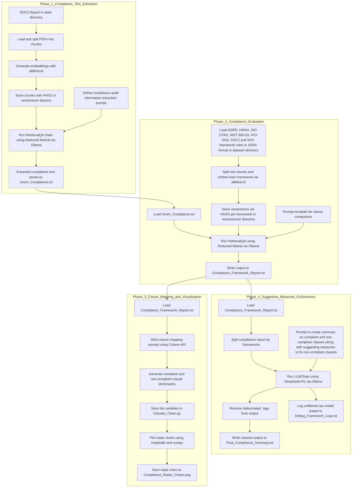
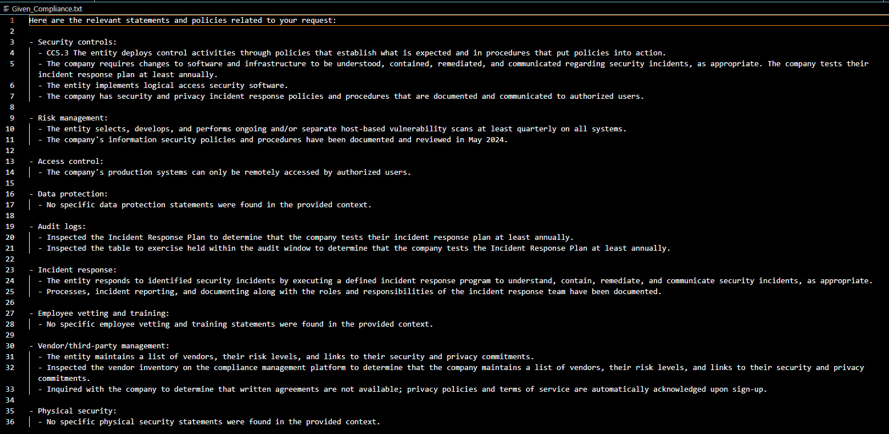
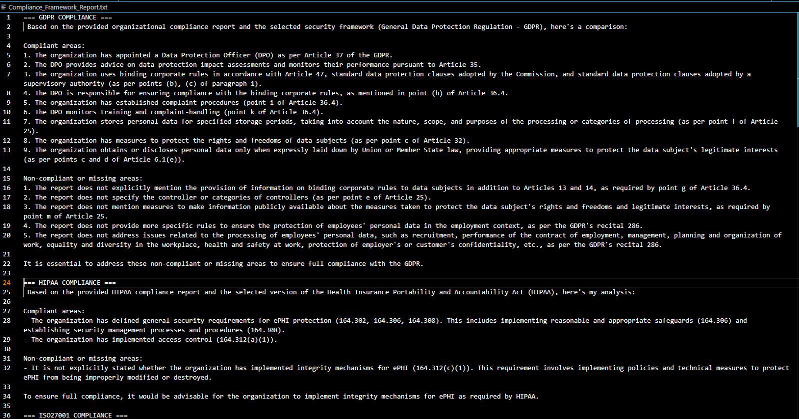
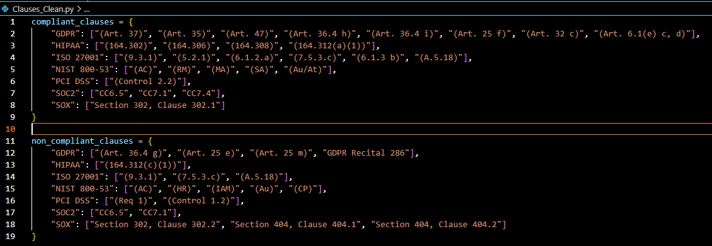
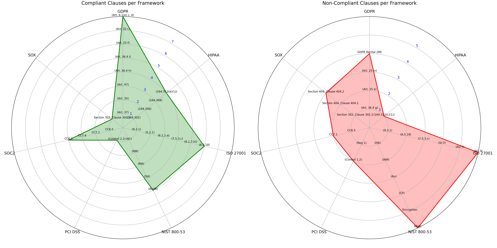
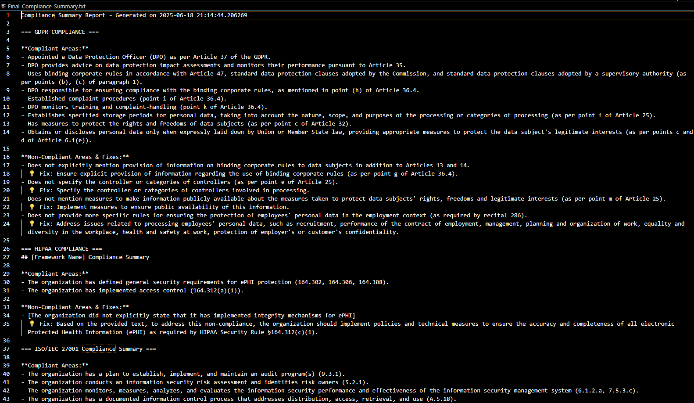
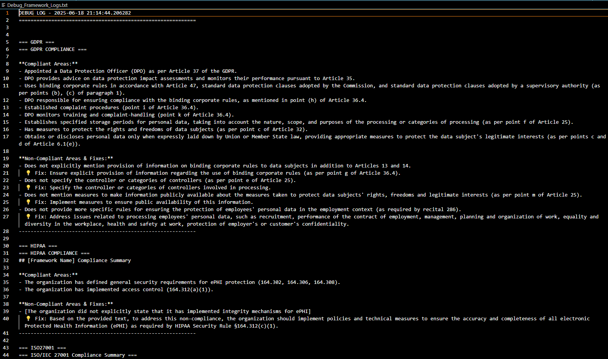
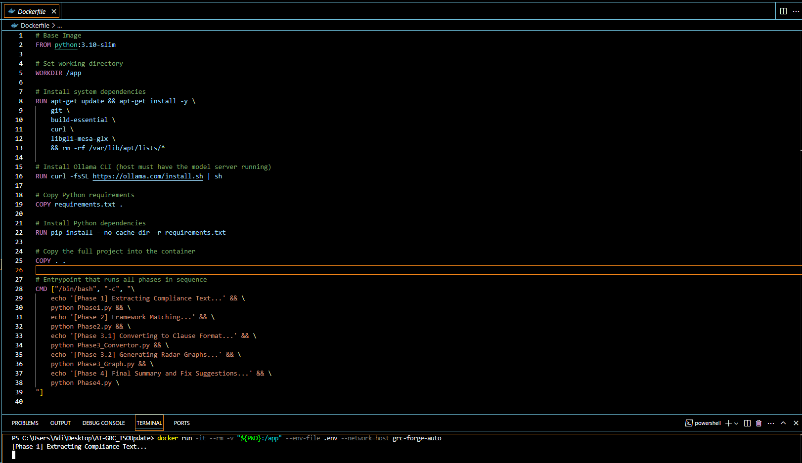

# GRC-Forge 🛡️  
**AI-Powered Multi-Framework Compliance Automation Toolkit**  
Built as part of an internship at Ernst & Young (EY)

---

## 📌 Overview

**GRC-Forge** is a modular, offline-first pipeline designed to automate the compliance audit process across multiple security frameworks including SOC 2, ISO 27001, HIPAA, NIST 800-53, SOX, GDPR, and PCI DSS. It leverages local LLMs, vector embeddings, and prompt-engineered pipelines to extract, compare, classify, and visualize the compliance posture of an organization.

> This project was developed as a core deliverable during a cybersecurity internship at EY, focused on transforming static compliance reviews into scalable, AI-assisted audit workflows.

---

## Visual Pipeline



---

## ⚙️ Key Features

- Extracts security-specific clauses from long audit documents (e.g., SOC 2 PDFs)
- Benchmarks against 7+ frameworks using LangChain, FAISS, and HuggingFace embeddings
- Automatically maps compliant and non-compliant clauses
- Generates professional summaries and remediation recommendations using LLMs
- Produces radar charts for clause-level visualization
- Fully offline, containerized, and enterprise-ready

---

## 🧠 Tech Stack

- **Python 3.11**
- **LangChain**, **FAISS**, **HuggingFace** embeddings
- **Ollama + Mistral**, **DeepSeek-R1** (local LLMs)
- **Cohere API** (for clause parsing)
- **Matplotlib**, **NumPy** (visualization)
- **PowerShell (`set.ps1`)** for setup automation
- **Docker** for reproducible environments

---

## 🗂️ Directory Structure

```

GRC-Forge/
├── data/                           # Input PDFs (SOC2 reports)
├── dataset/                        # JSON rules for frameworks
├── vectorstore/, vectorstore2/     # FAISS embeddings
├── Clauses_Clean.py                # Structured compliance data
├── Compliance_Framework_Report.txt
├── Compliance_Radar_Charts.png
├── Final_Compliance_Summary.txt
├── Dockerfile                      # Containerized execution pipeline
├── set.ps1                         # PowerShell setup & automation script
├── Phase1.py → Phase4.py           # Modular pipeline scripts

````

---

## 🚀 Setup & Execution

### Option 1: Run via Docker (Recommended)

```bash
docker build -t grc-forge-auto .
docker run -it --rm -v "$PWD:/app" --network=host grc-forge-auto
````

### Option 2: Automated Setup via PowerShell (Windows)

```powershell
.\set.ps1
```

This script installs dependencies, pulls Ollama models (`mistral:instruct`, `deepseek:latest`), creates required directories, and runs all pipeline phases in order.

---

## 🔄 Pipeline Phases

| Phase       | Description                                                        |
| ----------- | ------------------------------------------------------------------ |
| **Phase 1** | Extracts compliance clauses from PDFs using RetrievalQA (Mistral)  |
| **Phase 2** | Compares extracted clauses against frameworks (FAISS + JSONLoader) |
| **Phase 3** | Maps clauses to framework identifiers and generates radar charts   |
| **Phase 4** | Produces human-readable remediation summaries using DeepSeek-R1    |

---

## 📸 Results & Screenshots

| Phase                 | Output                                                  |
| --------------------- | ------------------------------------------------------- |
| Phase 1               |          |
| Phase 2               |          |
| Phase 3 - Clauses     |               |
| Phase 3 - Radar Graph |             |
| Phase 4 - Summary     |  |
| Phase 4 - Debug       |             |
| Docker Execution      |                        |

---

## 📈 Future Scope

* Extend support to ISO 27002, FedRAMP, CSA STAR
* Add clause confidence scoring and risk-weighted prioritization
* Secure secrets management via Docker + Vault
* Flask/FastAPI-based GUI for non-technical users
* Export summaries in SOC2 Bridge Letter or audit-ready templates
* Real-time GRC monitoring via streaming LLM APIs

---

## 👨‍💻 Author

**Aditya Bhatt**
BTech CSE | Cybersecurity | EY Intern

---
